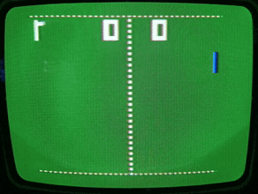

# Soundic TV Sports (SD-01) Pong Console - Full Schematic & Reverse Engineering

This repository contains the complete and verified schematic diagram for the **Soundic TV Sports (Model SD-01)** PAL color video game console, released in 1977.

Since no official service manuals or schematics for this hardware exist on the internet, this project aims to close that gap to preserve retro gaming history and assist with repairs, modding, and research.

## 🕹️ About the Hardware

The Soundic SD-01 belongs to the first generation of video game consoles. It is based on the **AY-3-8500** "Pong-on-a-chip" integrated circuit by General Instrument. Unlike cheaper black-and-white clones, this specific hardware features an elaborate discrete PAL chroma modulator utilizing a unique 8-diode phase alternating matrix.

The reverse engineering was performed on a device with serial number 16.

Here is a brief description of the individual functional blocks:

* **Power Supply:** The circuit around transistor Q1 generates the supply voltage for the console. The 9V input voltage is regulated to a stable 6.4V using a Zener diode and a series transistor. The only component powered directly by the 9V supply is the audio amplifier.
* **CPU:** The CPU U1 processes all button and paddle inputs, controls the gameplay, and outputs the corresponding signals required to generate the video image.
* **Video Generation:** Logic gates U2 and U3 combine the various outputs from U1 to create the composite luminance signals. This section also generates the line synchronization (H-Sync) signal, which is later used for color processing and television synchronization via the RF stage.
* **Color Generation:** The line synchronization signal is divided by 2 (via a discrete T-Flip-Flop) and fed into the diode matrix via transistors Q6/Q7 and filter FL1. This switches the phase of every second line by 180°, as is standard in PAL television systems. Transistor Q5 generates the 4.433618 MHz color carrier, which is also injected into the diode matrix. The colors are controlled via signals SIG_1, SIG_2, and SIG_3. The resulting chrominance signal passes through filter FL3 to the RF stage.
* **RF Stage:** Instead of a pre-assembled modulator block, a fully discrete circuit was used for the RF stage. The luminance and chrominance signals are amplified by Q4 and Q8, additively combined, and passed to the modulator. The actual RF carrier is generated by a Colpitts oscillator around transistor Q101. The modulated signal then passes through an impedance-matching network directly to the antenna connector.

### Compatible / Rebranded Consoles

Because this Hong Kong-manufactured PCB was widely exported and rebranded, this schematic is also highly relevant for repairing and understanding several identical or closely related systems, including:

* Hanimex TV Sports Game
* Conic TV Sports
* Academy / Acur / Telepartner
* Sportsmaster / Maspelsports
* ITMC / Univox / Tempest

## 📁 Repository Structure

* `/kicad_schematic/` - Complete schematic files designed with KiCad E.D.A. (v10.0 or later).
* `/pdfs/` - Exported PDF schematics and Layout for easy viewing.
* `/pictures/` - Photographs of the console, the main PCB and switch PCB and some details.
* `/vector graphics` - Photographs of the main and switch PCB featuring an annotated component placement guide created via Inkscape to simplify orientation and signal tracing on the real board.
* `/curves/` - Reference oscillograms captured during troubleshooting and calibration.

**Note on component designations:** I made every effort to read all original component designations directly from the circuit board. Unfortunately, some labels were duplicated, and others were completely illegible due to being hidden underneath components or obscured by sealing wax. In these cases, designations were assigned using logical deduction. Notes have been added to the schematic wherever a component name had to be inferred or substituted.

## 🤝 Contribution & Collaboration Welcomed!

This is an open-source hardware preservation project, and your help is highly appreciated!

### How you can help:

1. **Report Bugs & Verification:** If you are working on a similar console and notice any component value discrepancies or missing traces, please open an **Issue**. Let's refine the schematic together!
2. **PCB Layout / Redesign:** I am currently focusing entirely on the schematic side and do not plan to design a PCB layout. If you want to contribute a 1:1 replacement PCB layout or a modernized component replica in KiCad, feel free to submit a **Pull Request**!
3. **High-Resolution Photos Needed:** Unfortunately, I forgot to take high-quality studio/reference photographs while I had the console fully disassembled. If you own an SD-01 (or an identical clone) and can provide clean, well-lit, high-resolution top and bottom photos of the PCB, the switch assembly, or other chassis details, please submit them! They will be used to create a proper visual PCB guide.
4. **Service Hints:** If anyone has additional service information, especially regarding the exact alignment procedures for filters FL1 to FL3, contributions are very welcome.
5. **In-Depth Circuit Description:** Any contributions providing an even more detailed or academic breakdown of the analog circuitry are highly appreciated.
6. **Other Versions** If someone has a device with NTSC standard and can contribute the circuit diagram for the RF section.

---

## ⚖️ License & Legal Disclaimer

### License

This documentation, the photos and the KiCad schematic files are dedicated to the public domain under the **CC0 1.0 Universal (CC0 1.0) Public Domain Dedication**. You can copy, modify, and distribute this work, even for commercial purposes, all without asking permission.

### Legal & Copyright Disclaimer

* **Original Intellectual Property:** The underlying electronic circuit design and hardware architecture were developed in 1977 and remain the intellectual property of their respective original manufacturers (Soundic / General Instrument). This reverse-engineered schematic is intended solely for educational, repair, and historical preservation purposes.
* **No Warranty:** This schematic was drawn with great care and verified with professional equipment, but it is provided "as-is" without any warranties. Working with vintage electronics and mains-operated power supplies involves risks. The author is not responsible for any damage to your hardware, tools, or person.

---

